<p align="center">
  <a href="https://answerloops.com?utm_source=github&amp;utm_medium=readme&amp;utm_campaign=repo&amp;utm_content=hero">
    
  </a>
</p>

<h1 align="center">answerLoops</h1>

<p align="center"><strong>Help your community grow</strong></p>

<p align="center">Give members a reason to come back and website visitors answers before they leave. One knowledge base powers both.</p>

<p align="center">
  <a href="#get-started"><strong>Self-host →</strong></a> ·
  <a href="https://answerloops.com/login?plan=standard&amp;interval=monthly&amp;utm_source=github&amp;utm_medium=readme&amp;utm_campaign=repo&amp;utm_content=hero&amp;ref=readme"><strong>Try hosted →</strong></a> ·
  <a href="https://answerloops.com/docs/integrations/agent-skills?utm_source=github&amp;utm_medium=readme&amp;utm_campaign=repo&amp;utm_content=hero">Connect your agent</a> ·
  <a href="https://answerloops.com/docs?utm_source=github&amp;utm_medium=readme&amp;utm_campaign=repo&amp;utm_content=hero">Docs</a>
</p>

<div align="center">

[](https://github.com/answerLoops/answerLoops/stargazers)
[](https://github.com/answerLoops/answerLoops/actions/workflows/ci.yml)
[](https://github.com/answerLoops/answerLoops/actions/workflows/security.yml)
[](./LICENSE)
[](https://www.npmjs.com/package/@answerloops/agent-sdk)
[](https://cycode.com)
</div>

<a id="why-answerloops"></a>

## Give members help where they already ask

answerLoops is open-source AI support for online communities and customer teams. Give a new member a clear next step, help a learner get back to a course, or pick up a question that needs a personal reply. Connect the channels you already use and answer from the guides your team maintains.

- **Keep the conversation in the community.** Connect Discord, Slack, Discourse, Circle, GitHub, Telegram, email, Google Chat, and a website widget.
- **Keep your team in the loop.** Review drafts and see which questions still need attention in one shared inbox. Pro and Enterprise add escalation routing, customer satisfaction ratings, and knowledge gap reports.
- **Make useful answers available again.** Import guides from URLs, files, GitHub, and Notion. Save a useful resolution as a knowledge base article that can inform future replies.
- **Use your own infrastructure and tools.** Self-host with a supported model or use the hosted app. Connect your own agents through MCP, the REST API, or the TypeScript SDK.

## How a member gets an answer

For connected support channels, answerLoops drafts from your knowledge base and checks the draft against its sources in a separate AI review. Automatic replies are off by default. Your team chooses which channels can send qualifying replies automatically.



## Give website visitors answers without leaving the page

Add the AnswerLoops chat widget to a website or docs site that supports custom JavaScript. Visitors get answers without signing up, using published articles from the same knowledge base that supports your community.


When your articles don’t cover a question, the widget can ask for an email so your team can follow up. [Install the website chat widget](https://answerloops.com/docs/product/chat-widget#set-it-up).

<details>
<summary><strong>See the workspace</strong></summary>


</details>

## Get started

**Self-host with one command**

```bash
npx @answerloops/agent-sdk setup
```

You'll need Node.js, Git, Docker with Compose, a PostgreSQL connection, Google OAuth credentials, and an AI provider key. The command checks prerequisites, generates your secrets, starts the published image, and verifies `/api/health`. If something is missing, it tells you what to add to `.env`. Add it and run the command again. See the [self-hosting guide](https://answerloops.com/docs/quickstart-self-host?utm_source=github&utm_medium=readme&utm_campaign=repo&utm_content=get-started) for each value, or the [Docker guide](https://answerloops.com/docs/self-hosting/docker?utm_source=github&utm_medium=readme&utm_campaign=repo&utm_content=get-started) if you'd rather run Compose yourself.

**Use the hosted app**

[Start a free trial](https://answerloops.com/login?plan=standard&interval=monthly&utm_source=github&utm_medium=readme&utm_campaign=repo&utm_content=get-started&ref=readme) and add your docs.

**Let your agent set it up**

```bash
npx @answerloops/agent-sdk skills answerloops-setup answerloops-operate
```

This installs two Claude Code skills, one to set up a new instance and one to operate an existing workspace. Other MCP clients can connect through the [MCP guide](https://answerloops.com/docs/integrations/mcp?utm_source=github&utm_medium=readme&utm_campaign=repo&utm_content=get-started). Everything your agent can do is in the [agent skills guide](https://answerloops.com/docs/integrations/agent-skills?utm_source=github&utm_medium=readme&utm_campaign=repo&utm_content=get-started).

## How can I help
**If answerLoops helps your community, a ⭐ helps others find it.**

## How it compares

Read our [comparison with Kapa.ai](https://answerloops.com/vs/kapa-ai), or see how answerLoops handles [support across community platforms](https://answerloops.com/blog/managing-every-community-platform-from-one-place) and what we learned [running an AI support bot on a local model](https://answerloops.com/blog/run-an-ai-support-bot-on-a-local-model).

| | answerLoops | Chatwoot | Zammad | Kapa.ai |
| --- | --- | --- | --- | --- |
| **License (self-hosted)** | AGPL-3.0 | AGPL-3.0 | AGPL-3.0 | No public self-hosted option |
| **Community channels** | Discord, Slack, Discourse, Circle, GitHub, Telegram, Email, Google Chat, Website widget | Website chat, email, WhatsApp, Telegram, Facebook, Instagram, Slack, SMS — no Discord | Email, chat, phone, WhatsApp, Facebook, Telegram — no Discord or Slack | Discord, Slack, website widget — no Telegram, Discourse, Circle, or email |
| **AI in the self-hosted tier** | Dual-agent draft-and-review pipeline included, no per-call metering | BYOK AI assistant, gated to paid/Enterprise tiers | Paid add-on even when self-hosted — €0.03 per AI call | Not applicable — hosted only |

Sources: [Chatwoot](https://www.chatwoot.com/pricing/self-hosted-plans), [Zammad](https://zammad.com/en/product/artificial-intelligence), [Kapa.ai](https://docs.kapa.ai/overview/showcase).

<details>
<summary><strong>FAQ</strong></summary>

**Does answerLoops work with Discord and Slack at the same time?** Yes. Every connected channel shares one knowledge base and one ticket queue.

**Can I run answerLoops fully self-hosted with my own LLM?** Yes. It's AGPL-3.0 and ships as a Docker Compose stack. Connect OpenAI, Anthropic, Google Gemini, Groq, Mistral, Ollama, or any OpenAI-compatible endpoint, including a local model.

**When does answerLoops reply automatically?** Automatic replies are off by default on connected support channels. A separate review step checks drafts against their sources. When you enable automatic replies for a channel, drafts can post if they meet its confidence threshold. Other drafts wait for your team.

**Does answerLoops support MCP?** Yes. An MCP server at `/api/mcp` lets any MCP-compatible agent search knowledge, read the FAQ digest, list and create tickets, and generate answers. REST, OpenAPI, and a TypeScript SDK expose the same operations. See the [Agent API reference](https://answerloops.com/docs/integrations/agent-api?utm_source=github&utm_medium=readme&utm_campaign=repo&utm_content=faq).
</details>

## Learn more

- [Documentation](https://answerloops.com/docs?utm_source=github&utm_medium=readme&utm_campaign=repo&utm_content=learn-more)
- [Self-hosting guide](https://answerloops.com/docs/quickstart-self-host?utm_source=github&utm_medium=readme&utm_campaign=repo&utm_content=learn-more)
- [Agent API and MCP](https://answerloops.com/docs/integrations/mcp?utm_source=github&utm_medium=readme&utm_campaign=repo&utm_content=learn-more)
- [TypeScript SDK](./packages/agent-sdk/README.md)
- [Chat widget package](./packages/widget/README.md)
- [Architecture guide](./ARCHITECTURE.md)

## Contributing

Contributions are welcome. Read [CONTRIBUTING.md](./CONTRIBUTING.md) for how to run answerLoops locally, the repository layout, and how to submit a pull request. Tried it on your own docs? [Open an issue](https://github.com/answerLoops/answerLoops/issues) with what worked and where you got stuck, without private support conversations or credentials. Report security issues privately through [SECURITY.md](./SECURITY.md).

## License

[AGPL-3.0](./LICENSE). Read it, change it, run it yourself. If you run a modified version as a network service, the AGPL requires you to make that source available to its users. That's a stronger guarantee against a silent closed-source fork than MIT or Apache-2.0, and it's why answerLoops isn't an "open core" product with the real features behind a paid tier. Self-hosting also keeps your community's questions and documentation on infrastructure you control, with no per-resolution pricing.

<div align="center">

[Docs](https://answerloops.com/docs?utm_source=github&utm_medium=readme&utm_campaign=repo&utm_content=footer) · [Get started](#get-started) · [Open an issue](https://github.com/answerLoops/answerLoops/issues)

</div>
