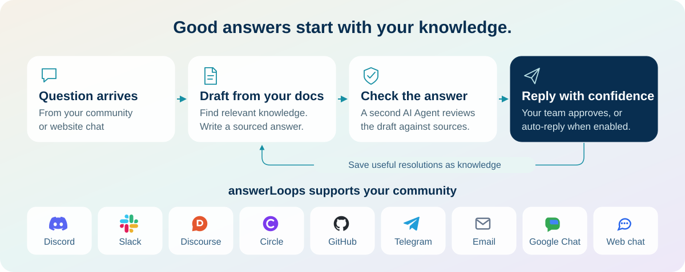
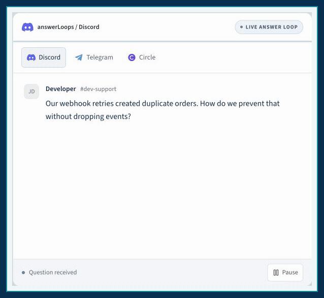
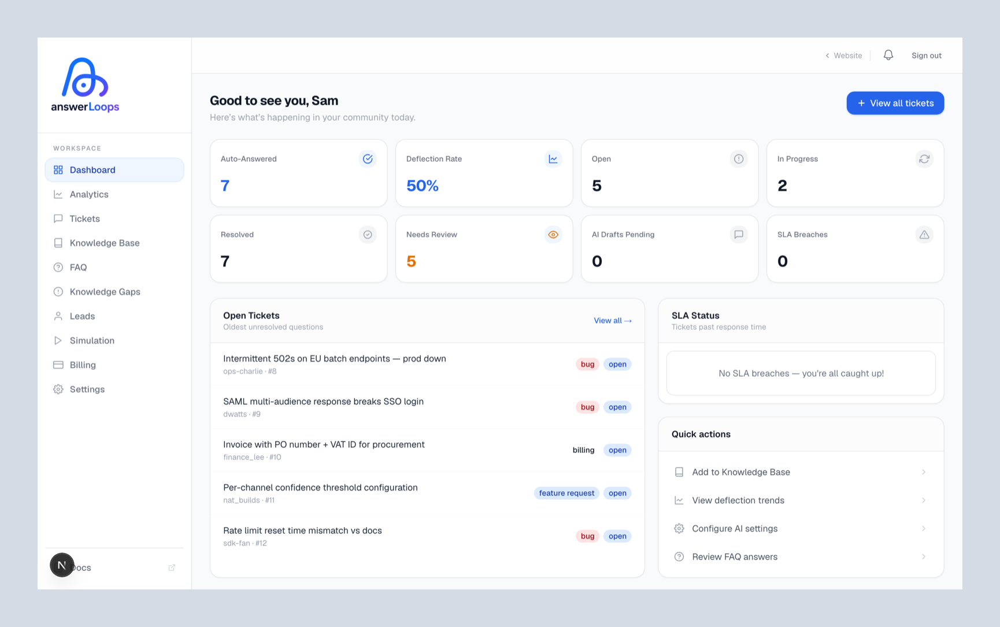
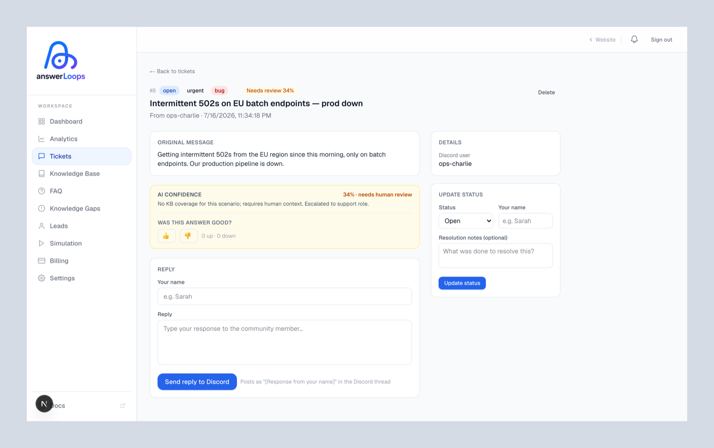

<p align="center">
  <a href="https://answerloops.com?utm_source=github&amp;utm_medium=readme&amp;utm_campaign=repo&amp;utm_content=hero">
    
  </a>
</p>

<h1 align="center">answerLoops</h1>

<p align="center"><strong>Turn your docs into answers for your community.</strong></p>

<p align="center">Self-hostable AI support for your community. Source-backed replies, checked by a second AI Agent, and approved by your team before it's sent. Run it on your own infrastructure with your preferred LLM model, connect your own agents or use the hosted app.</p>

<p align="center">
  <a href="#get-started"><strong>Self-host →</strong></a> ·
  <a href="https://answerloops.com/login?plan=standard&amp;interval=monthly&amp;utm_source=github&amp;utm_medium=readme&amp;utm_campaign=repo&amp;utm_content=hero&amp;ref=readme"><strong>Try hosted →</strong></a> ·
  <a href="https://answerloops.com/docs/integrations/agent-skills?utm_source=github&amp;utm_medium=readme&amp;utm_campaign=repo&amp;utm_content=hero">Connect your agent</a> ·
  <a href="https://answerloops.com/docs?utm_source=github&amp;utm_medium=readme&amp;utm_campaign=repo&amp;utm_content=hero">Docs</a>
</p>

<p align="center">
  
</p>

<div align="center">

[](https://github.com/answerLoops/answerLoops/stargazers)
[](https://github.com/answerLoops/answerLoops/actions/workflows/ci.yml)
[](https://github.com/answerLoops/answerLoops/actions/workflows/security.yml)
[](./LICENSE)
[](https://www.npmjs.com/package/@answerloops/agent-sdk)
</div>

<a id="why-answerloops"></a>

## Stop answering the same question from scratch

Your docs already cover setup, troubleshooting, and the questions people ask frequently. answerLoops puts that knowledge to work where the conversation happens.

- **Integrations.** Discord, Slack, Discourse, Circle, GitHub, Telegram, Google Chat, email, and website chat.
- **Knowledge.** Import your documentation, files, GitHub repositories, and Notion pages. Every reply comes with its sources attached.
- **Review.** A second AI Agent checks each draft against its sources. Your team approves it, or you turn on auto-reply for questions that pass.
- **Tickets.** One shared inbox for every channel, with triage, SLAs, human escalation, CSAT, and analytics.
- **Agents.** MCP, REST, OpenAPI, a TypeScript SDK, and Claude Code skills for your own AI tools.
- **AI providers.** OpenAI, Anthropic, Google Gemini, Groq, Mistral, Ollama, or any OpenAI-compatible endpoint, including local models.
- **Learning.** Save useful resolutions as knowledge articles, and use knowledge gaps and FAQ digests to see what your docs are missing.

<p align="center">
  <a href="https://answerloops.com/?utm_source=github&utm_medium=readme&utm_campaign=repo&utm_content=answer-loop#main-content">
    
  </a>
</p>

<br />

<div align="center">
One dashboard for every support channel
</div>

<br />

<div align="center">
See why the AI answered, and hand off when it shouldn't
</div>


## Get started

**Self-host with one command**

```bash
npx @answerloops/agent-sdk setup
```

You'll need Node.js, Git, Docker with Compose, a PostgreSQL connection, Google OAuth credentials, and an AI provider key. The command checks prerequisites, generates your secrets, starts the published image, and verifies `/api/health`. If something is missing, it tells you what to add to `.env`. Add it and run the command again. See the [self-hosting guide](https://answerloops.com/docs/quickstart-self-host?utm_source=github&utm_medium=readme&utm_campaign=repo&utm_content=get-started) for each value, or the [Docker guide](https://answerloops.com/docs/self-hosting/docker?utm_source=github&utm_medium=readme&utm_campaign=repo&utm_content=get-started) if you'd rather run Compose yourself.

**Use the hosted app**

[Start a free trial](https://answerloops.com/login?plan=standard&interval=monthly&utm_source=github&utm_medium=readme&utm_campaign=repo&utm_content=get-started&ref=readme) and add your docs.

**Let your agent set it up**

```bash
npx @answerloops/agent-sdk skills answerloops-setup answerloops-operate
```

This installs two Claude Code skills, one to set up a new instance and one to operate an existing workspace. Other MCP clients can connect through the [MCP guide](https://answerloops.com/docs/integrations/mcp?utm_source=github&utm_medium=readme&utm_campaign=repo&utm_content=get-started). Everything your agent can do is in the [agent skills guide](https://answerloops.com/docs/integrations/agent-skills?utm_source=github&utm_medium=readme&utm_campaign=repo&utm_content=get-started).

## How can I help
**If answerLoops helps your community, a ⭐ helps others find it.**

## How it compares

| | answerLoops | Chatwoot | Zammad | Kapa.ai |
| --- | --- | --- | --- | --- |
| **License (self-hosted)** | AGPL-3.0 | AGPL-3.0 | AGPL-3.0 | No public self-hosted option |
| **Community channels** | Discord, Slack, Discourse, Circle, GitHub, Telegram, email, Google Chat, website widget | Website chat, email, WhatsApp, Telegram, Facebook, Instagram, Slack, SMS — no Discord | Email, chat, phone, WhatsApp, Facebook, Telegram — no Discord or Slack | Discord, Slack, website widget — no Telegram, Discourse, Circle, or email |
| **AI in the self-hosted tier** | Dual-agent draft-and-review pipeline included, no per-call metering | BYOK AI assistant, gated to paid/Enterprise tiers | Paid add-on even when self-hosted — €0.03 per AI call | Not applicable — hosted only |

Sources: [Chatwoot](https://www.chatwoot.com/pricing/self-hosted-plans), [Zammad](https://zammad.com/en/product/artificial-intelligence), [Kapa.ai](https://docs.kapa.ai/overview/showcase).

<details>
<summary><strong>FAQ</strong></summary>

**Does answerLoops work with Discord and Slack at the same time?** Yes. Every connected channel shares one knowledge base and one ticket queue.

**Can I run answerLoops fully self-hosted with my own LLM?** Yes. It's AGPL-3.0 and ships as a Docker Compose stack. Connect OpenAI, Anthropic, Google Gemini, Groq, Mistral, Ollama, or any OpenAI-compatible endpoint, including a local model.

**Does an AI-drafted answer get reviewed before it's sent?** Yes, always. A separate review agent checks every draft against its sources and assigns a confidence score. Automatic replies are off by default per channel. Even a high-confidence draft waits for a person to approve it until you turn that setting on.

**Does answerLoops support MCP?** Yes. An MCP server at `/api/mcp` lets any MCP-compatible agent search knowledge, read the FAQ digest, list and create tickets, and generate answers. REST, OpenAPI, and a TypeScript SDK expose the same operations. See the [Agent API reference](https://answerloops.com/docs/integrations/agent-api?utm_source=github&utm_medium=readme&utm_campaign=repo&utm_content=faq).
</details>

## Learn more

- [Documentation](https://answerloops.com/docs?utm_source=github&utm_medium=readme&utm_campaign=repo&utm_content=learn-more)
- [Self-hosting guide](https://answerloops.com/docs/quickstart-self-host?utm_source=github&utm_medium=readme&utm_campaign=repo&utm_content=learn-more)
- [Agent API and MCP](https://answerloops.com/docs/integrations/mcp?utm_source=github&utm_medium=readme&utm_campaign=repo&utm_content=learn-more)
- [TypeScript SDK](./packages/agent-sdk/README.md)
- [Architecture guide](./ARCHITECTURE.md)

## Contributing

Contributions are welcome. Read [CONTRIBUTING.md](./CONTRIBUTING.md) for how to run answerLoops locally, the repository layout, and how to submit a pull request. Tried it on your own docs? [Open an issue](https://github.com/answerLoops/answerLoops/issues) with what worked and where you got stuck, without private support conversations or credentials. Report security issues privately through [SECURITY.md](./SECURITY.md).

## License

[AGPL-3.0](./LICENSE). Read it, change it, run it yourself. If you run a modified version as a network service, the AGPL requires you to make that source available to its users. That's a stronger guarantee against a silent closed-source fork than MIT or Apache-2.0, and it's why answerLoops isn't an "open core" product with the real features behind a paid tier. Self-hosting also keeps your community's questions and documentation on infrastructure you control, with no per-resolution pricing.

<div align="center">

[Docs](https://answerloops.com/docs?utm_source=github&utm_medium=readme&utm_campaign=repo&utm_content=footer) · [Get started](#get-started) · [Open an issue](https://github.com/answerLoops/answerLoops/issues)

</div>
