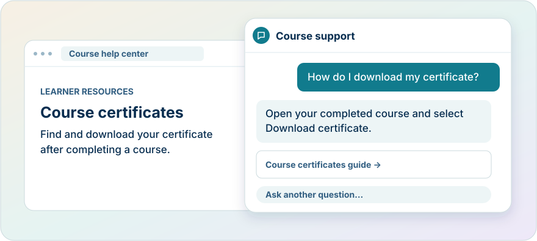
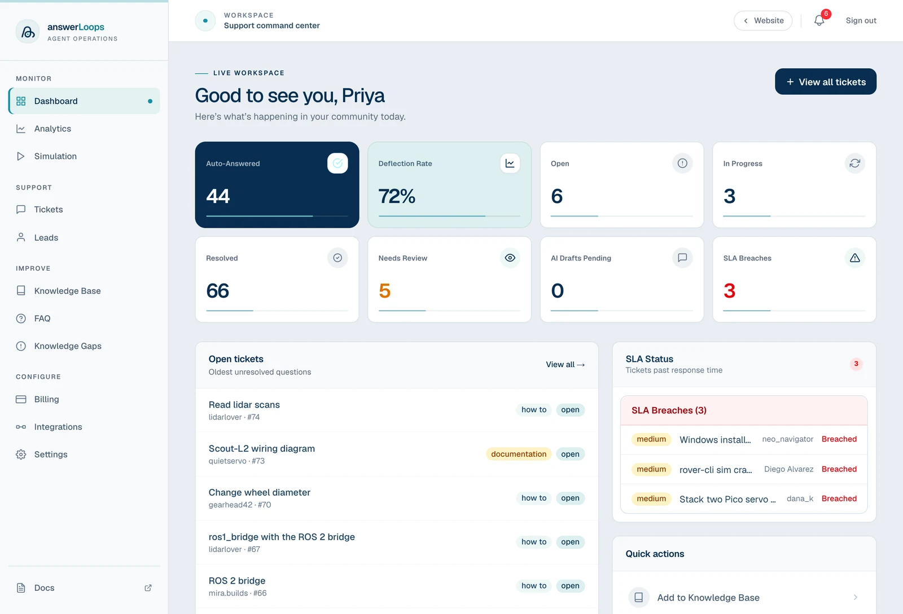
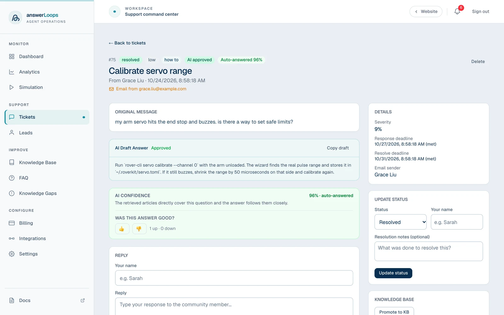

<p align="center">
  <a href="https://answerloops.com?utm_source=github&amp;utm_medium=readme&amp;utm_campaign=repo&amp;utm_content=hero">
    
  </a>
</p>

<h1 align="center">answerLoops</h1>

<h2 align="center"><strong>Make Your Community More Valuable to Members.</strong></h2>

<p align="center">Turn your existing knowledge into trusted answers that keep members engaged.</p>

<p align="center">
  <a href="#get-started"><strong>Self-host →</strong></a> ·
  <a href="https://answerloops.com/login?plan=standard&amp;interval=monthly&amp;utm_source=github&amp;utm_medium=readme&amp;utm_campaign=repo&amp;utm_content=hero&amp;ref=readme"><strong>Try hosted →</strong></a> ·
  <a href="https://answerloops.com/docs/integrations/agent-skills?utm_source=github&amp;utm_medium=readme&amp;utm_campaign=repo&amp;utm_content=hero">Connect your agent</a> ·
  <a href="#give-website-visitors-answers-without-leaving-the-page">Website chat</a> ·
  <a href="https://answerloops.com/docs?utm_source=github&amp;utm_medium=readme&amp;utm_campaign=repo&amp;utm_content=hero">Docs</a>
</p>

<div align="center">

[](https://github.com/answerLoops/answerLoops/stargazers)
[](https://github.com/answerLoops/answerLoops/actions/workflows/ci.yml)
[](https://github.com/answerLoops/answerLoops/actions/workflows/security.yml)
[](./LICENSE)
[](https://github.com/answerLoops/answerLoops/pkgs/container/answerloops)
[](https://cycode.com)
</div>

<a id="why-answerloops"></a>


People join a community to learn something, solve a problem, or connect with others. A useful answer helps them do what they came for. Getting that help in the conversation they’re already in makes it easier to take part again. answerLoops is open-source AI support built around that idea.

- **Make your guides useful in the moment.** answerLoops drafts replies from the knowledge you already maintain. A separate AI checks each draft against its sources.
- **Keep the conversation going.** Members can get back to the workshop, discussion, or project they came for. Your team has one inbox for questions that need a personal reply.
- **Give members a reason to return.** When your team solves something new, save the answer as an article so it can help another member later.
- **Support more people as you grow.** The same knowledge base powers answers in your community and on your website, where newcomers can get help before they decide to join.

## How a member gets an answer

When a member asks where to watch a workshop replay, answerLoops can find the right guide and draft a reply with the link. Your team can review the draft before it goes out or enable automatic replies for answers that qualify. Automatic replies are off by default. If the guides don’t cover the question, your team can follow up.


## Answer questions directly from your knowledge source on your website or docs

Give people answers without making them sign up. Website chat uses the same guides that support your community. Try it [here](https://answerloops.com?ref=README).

**Add chat to your website in three easy steps**

1. Choose the guides visitors can get answers from.
2. Add the chat bubble to your website.
3. Ask a question to see what visitors will get.




_Custom branding is available so the chat can match your site’s look and feel._

When your articles don’t cover a question, the widget can ask for an email so your team can follow up.


[Install the website chat widget](https://answerloops.com/docs/product/chat-widget#set-it-up).

<details>
<summary><strong>See the workspace</strong></summary>





</details>

## Get started

**Self-host with one command**

```bash
npx @answerloops/agent-sdk setup
```

You'll need Node.js, Git, Docker with Compose, a PostgreSQL connection, Google OAuth credentials, and an AI provider key. The command checks prerequisites, generates your secrets, starts the published image, and verifies `/api/health`. If something is missing, it tells you what to add to `.env`. Add it and run the command again. See the [self-hosting guide](https://answerloops.com/docs/quickstart-self-host?utm_source=github&utm_medium=readme&utm_campaign=repo&utm_content=get-started) for each value, or the [Docker guide](https://answerloops.com/docs/self-hosting/docker?utm_source=github&utm_medium=readme&utm_campaign=repo&utm_content=get-started) if you'd rather run Compose yourself.

**Use the hosted app**

[Start a free trial](https://answerloops.com/login?plan=standard&interval=monthly&utm_source=github&utm_medium=readme&utm_campaign=repo&utm_content=get-started&ref=readme) and add your docs.

**Let your agent set it up**

```bash
npx @answerloops/agent-sdk skills answerloops-setup answerloops-operate
```

This installs two Claude Code skills, one to set up a new instance and one to operate an existing workspace. Other MCP clients can connect through the [MCP guide](https://answerloops.com/docs/integrations/mcp?utm_source=github&utm_medium=readme&utm_campaign=repo&utm_content=get-started). Everything your agent can do is in the [agent skills guide](https://answerloops.com/docs/integrations/agent-skills?utm_source=github&utm_medium=readme&utm_campaign=repo&utm_content=get-started).

## Community

- [Ask a question in GitHub Discussions](https://github.com/answerLoops/answerLoops/discussions). Get help setting up answerLoops or share what you’re trying to do.
- [Follow @answerLoops on X](https://x.com/answerLoops). See product updates and what we’re working on.
- [Star the repository](https://github.com/answerLoops/answerLoops). Help other teams find answerLoops.

## How it compares

Read our side-by-side comparisons with [Kapa.ai](https://answerloops.com/vs/kapa-ai), [Bettermode](https://answerloops.com/vs/bettermode), [Intercom Fin](https://answerloops.com/vs/intercom), and [Pylon](https://answerloops.com/vs/pylon), or [browse all comparisons](https://answerloops.com/alternatives).

| | answerLoops | Chatwoot | Zammad | Kapa.ai |
| --- | --- | --- | --- | --- |
| **License (self-hosted)** | AGPL-3.0 | AGPL-3.0 | AGPL-3.0 | No public self-hosted option |
| **Community channels** | Discord, Slack, Discourse, Circle, GitHub, Telegram, Email, Google Chat, Website widget | Website chat, email, WhatsApp, Telegram, Facebook, Instagram, Slack, SMS — no Discord | Email, chat, phone, WhatsApp, Facebook, Telegram — no Discord or Slack | Discord, Slack, website widget — no Telegram, Discourse, Circle, or email |
| **AI in the self-hosted tier** | Dual-agent draft-and-review pipeline included, no per-call metering | BYOK AI assistant, gated to paid/Enterprise tiers | Paid add-on even when self-hosted — €0.03 per AI call | Not applicable — hosted only |

Sources: [Chatwoot](https://www.chatwoot.com/pricing/self-hosted-plans), [Zammad](https://zammad.com/en/product/artificial-intelligence), [Kapa.ai](https://docs.kapa.ai/overview/showcase).

## FAQ

<details>
<summary><strong>What does answerLoops do?</strong></summary>

answerLoops uses one knowledge base to help members in your community and visitors on your website. For connected community channels, it drafts a reply from your guides and checks it against the sources in a separate AI review. You can save useful resolutions as articles for future questions.

</details>

<details>
<summary><strong>Who uses answerLoops?</strong></summary>

Community managers, course and membership teams, open-source maintainers, and customer support teams use answerLoops to answer questions from their own guides and FAQs.

</details>

<details>
<summary><strong>Does answerLoops work with Discord and Slack at the same time?</strong></summary>

Yes. Every connected channel shares one knowledge base and one ticket queue.

</details>

<details>
<summary><strong>What can I use as a knowledge source?</strong></summary>

Import documentation pages, upload files, or connect a GitHub repository or Notion workspace. You can also save useful ticket resolutions to the knowledge base.

</details>

<details>
<summary><strong>Can I review answers before they are sent?</strong></summary>

Yes, for connected community channels. Automatic replies are off by default, so your team can review drafts first. Questions that need attention stay in your team’s queue.

</details>

<details>
<summary><strong>When does answerLoops reply automatically?</strong></summary>

Automatic replies are off by default on connected support channels. A separate review step checks drafts against their sources. When you enable automatic replies for a channel, drafts can post if they meet its confidence threshold. Other drafts wait for your team.

</details>

<details>
<summary><strong>Can I add the chat widget to my website or docs?</strong></summary>

Yes. The widget works on websites and docs platforms that support custom JavaScript. Visitors can get answers from your published knowledge base articles without an account. See the [widget setup guide](https://answerloops.com/docs/product/chat-widget#set-it-up).

</details>

<details>
<summary><strong>Do I need an AI provider account?</strong></summary>

You can start without one on the hosted service. The trial and paid plans include AI usage, which counts work on drafts as well as replies. Included AI usage and automatic reply allowances are measured separately. You can connect a supported provider to keep drafting beyond the included AI usage and pay that provider directly. See [pricing and model costs](https://answerloops.com/pricing).

</details>

<details>
<summary><strong>Can I run answerLoops fully self-hosted with my own LLM?</strong></summary>

Yes. It's AGPL-3.0 and ships as a Docker Compose stack. Connect OpenAI, Anthropic, Google Gemini, Groq, Mistral, Ollama, or any OpenAI-compatible endpoint, including a local model.

</details>

<details>
<summary><strong>How do I onboard an AI agent?</strong></summary>

Start with the [agent onboarding guide](https://answerloops.com/docs/integrations/agent-skills). Use the `answerloops-operate` skill with compatible tools, or connect through MCP or the REST API. Create a scoped workspace API key to choose what the agent can access.

</details>

<details>
<summary><strong>Can my own AI agents use answerLoops?</strong></summary>

Yes. Every hosted plan includes MCP and REST API access. Agents can search your knowledge base, read FAQs or tickets, generate answers, and create support tickets within their key’s permissions. Usage limits depend on your plan.

</details>

<details>
<summary><strong>Does answerLoops support MCP?</strong></summary>

Yes. An MCP server at `/api/mcp` lets any MCP-compatible agent search knowledge, read the FAQ digest, list and create tickets, and generate answers. REST, OpenAPI, and a TypeScript SDK expose the same operations. See the [Agent API reference](https://answerloops.com/docs/integrations/agent-api?utm_source=github&utm_medium=readme&utm_campaign=repo&utm_content=faq).

</details>

## Learn more

- [Documentation](https://answerloops.com/docs?utm_source=github&utm_medium=readme&utm_campaign=repo&utm_content=learn-more)
- [Self-hosting guide](https://answerloops.com/docs/quickstart-self-host?utm_source=github&utm_medium=readme&utm_campaign=repo&utm_content=learn-more)
- [Agent API and MCP](https://answerloops.com/docs/integrations/mcp?utm_source=github&utm_medium=readme&utm_campaign=repo&utm_content=learn-more)
- [TypeScript SDK](./packages/agent-sdk/README.md)
- [Chat widget package](./packages/widget/README.md)
- [Architecture guide](./ARCHITECTURE.md)

## Contributing

Contributions are welcome. Read [CONTRIBUTING.md](./CONTRIBUTING.md) for how to run answerLoops locally, the repository layout, and how to submit a pull request. [Open an issue](https://github.com/answerLoops/answerLoops/issues) to report a bug or request a feature. Keep private support conversations and credentials out of public posts. Report security issues privately through [SECURITY.md](./SECURITY.md).

## License

[AGPL-3.0](./LICENSE). Read it, change it, run it yourself. If you run a modified version as a network service, the AGPL requires you to make that source available to its users. That's a stronger guarantee against a silent closed-source fork than MIT or Apache-2.0, and it's why answerLoops isn't an "open core" product with the real features behind a paid tier. Self-hosting also keeps your community's questions and documentation on infrastructure you control, with no per-resolution pricing.

<div align="center">

[Docs](https://answerloops.com/docs?utm_source=github&utm_medium=readme&utm_campaign=repo&utm_content=footer) · [Get started](#get-started) · [Open an issue](https://github.com/answerLoops/answerLoops/issues)

</div>
